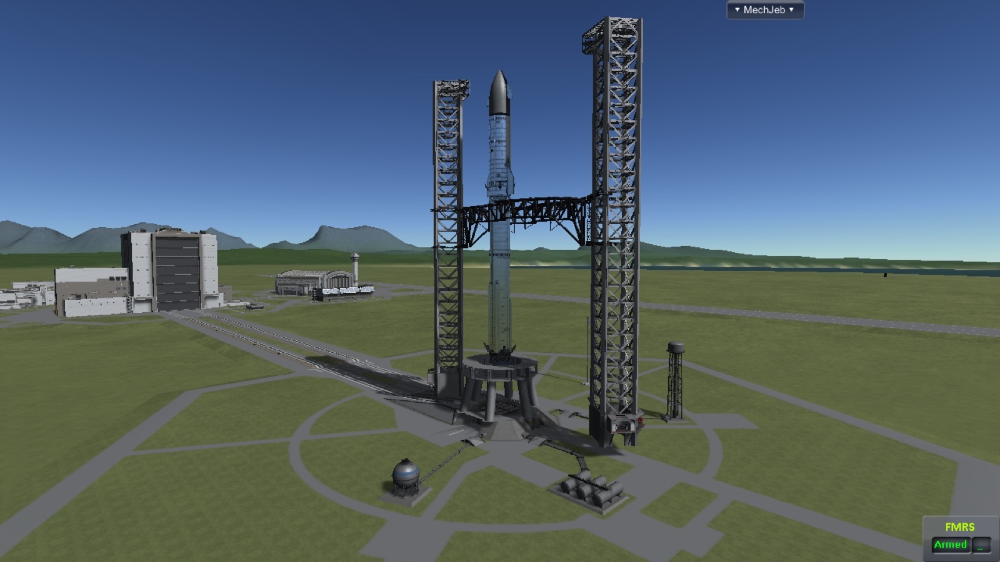

# D Starship for Kerbal Space Program

A mission fleet for **KSP 1.12.5** inspired by SpaceX Starship: 16 ready-to-fly Starship + Super Heavy stacks on twin launch towers, with side-door and clamshell cargo bays, a 9.6 m payload arm, a two-seat crew cabin, one-key controls and a tower booster catch.

## 📖 Start here: [The Beginner's Flight Manual](docs/MANUAL.md)

It takes you from "never played KSP" to orbit, cargo delivery, docking, Mun and Duna landings and booster recovery, with screenshots of every step.

## Quick install

1. **KSP 1.12.5** with the **Making History** and **Breaking Ground** DLCs.
2. Install [CKAN](https://github.com/KSP-CKAN/CKAN/releases/latest), then **File → Install from .ckan…** → [`deniz-starship.ckan`](deniz-starship.ckan). This installs every required mod. Keep **Starship Expansion Project at 3.1.0**.
3. *For the clamshell (C) craft:* copy 6 cargo-nose files from Tundra Exploration 5.1.0. See [manual §3.4](docs/MANUAL.md#34-one-manual-step-the-clamshell-nose-tundra-exploration-510).
4. Download the latest **[Release](../../releases/latest)** zip and copy its `GameData` and `Ships` folders into your KSP folder.
5. In the VAB, click **Load** and search `Deniz`.

## What's in this repo

| Folder | Contents |
|---|---|
| `GameData/` | The mod: part configs and the compiled plugin `DenizStarship.dll` |
| `Ships/VAB/` | 16 Tower Launch craft, Booster Practice, Drone Ship |
| `saves/` | A sandbox test save with the fleet (optional) |
| `docs/MANUAL.md` | The beginner manual |
| `docs/dev/` | Engineering status, full project log, test history |
| `source/` | Plugin C# source and the build and craft-generator scripts |
| `deniz-starship.ckan` | CKAN mod list |

## Required mods

Module Manager · **Starship Expansion Project 3.1.0** · Starship Launch Expansion 0.5 · B9 Part Switch · Waterfall · Shabby · Resurfaced · Community Resource Pack · CryoTanks · Station Parts Expansion Redux · SpaceDust · Kerbal Joint Reinforcement Next · KSP Community Fixes · *(clamshell only)* Tundra Exploration 5.1.0 cargo nose files.

Recommended: Kerbal Engineer Redux, MechJeb 2, Trajectories, FMRS.

## Credits and license

The D Starship plugin, configs, craft and docs are under the MIT license. See [LICENSE](LICENSE).
The models come from [Starship Expansion Project](https://github.com/Kari1407/Starship-Expansion-Project), [Starship Launch Expansion](https://github.com/SAMCG14/StarshipLaunchExpansion), [Tundra Exploration](https://github.com/TundraMods/TundraExploration), [SpaceDust](https://github.com/KSPModStewards/SpaceDust) and [Station Parts Expansion Redux](https://github.com/post-kerbin-mining-corporation/StationPartsExpansionRedux). They are **not** redistributed here; install them from their authors.
