# D Starship — The Beginner's Flight Manual

**This manual assumes you know nothing.** No KSP experience and no mod experience. Read it top to bottom once. After that, use the [cheat sheet](#20-one-page-cheat-sheet) at the end while you play.


*A full stack on the pad: Super Heavy (the booster, bottom), Starship (the ship, top), and the two launch towers that come with every craft.*

---

## Contents

1. [What this mod is](#1-what-this-mod-is)
2. [What you need](#2-what-you-need)
3. [Install the required mods (CKAN, step by step)](#3-install-the-required-mods)
4. [Install D Starship](#4-install-d-starship)
5. [KSP crash course: the words and screens you need](#5-ksp-crash-course)
6. [Your fleet: which craft does what](#6-your-fleet)
7. [The controls](#7-the-controls)
8. [Before every flight: the pad checklist](#8-before-every-flight)
9. [Mission 1: Launch to orbit](#9-mission-1-launch-to-orbit)
10. [Bringing the booster home (FMRS)](#10-bringing-the-booster-home)
11. [Delivering cargo in orbit](#11-delivering-cargo-in-orbit)
12. [Coming home: deorbit, entry and landing Starship](#12-coming-home)
13. [Docking and refuelling](#13-docking-and-refuelling)
14. [Going to the Mun](#14-going-to-the-mun)
15. [Going to Duna](#15-going-to-duna)
16. [Booster landing on the drone ship](#16-booster-landing-on-the-drone-ship)
17. [Advanced: catching the booster with the tower](#17-advanced-catching-the-booster-with-the-tower)
18. [Crew, EVA and the cabin](#18-crew-eva-and-the-cabin)
19. [When something goes wrong](#19-when-something-goes-wrong)
20. [One-page cheat sheet](#20-one-page-cheat-sheet)
21. [What has been tested, honestly](#21-what-has-been-tested-honestly)

---

## 1. What this mod is

D Starship is a **mission fleet for Kerbal Space Program 1** inspired by SpaceX Starship. It gives you:

- **16 ready-to-fly rockets.** Each is a 9-metre-wide Starship on top of a Super Heavy booster, standing between two launch towers. Each one carries a different payload: a satellite, a Hubble-style telescope, a Mun rover, a space station module, a fuel tanker, a Duna base, a crew rescue pod or an asteroid tug.
- **Two cargo styles:**
  - **Side doors** for compact payloads. The doors swing open on the side of the nose.
  - **Clamshell** for big payloads. The whole nose swings open. These have a **C** in the name, like *D Starship 2C Hubble*.
- **A robotic arm** that slides the cargo 9.6 m straight out of the bay and lets go of it.
- **A two-seat crew cabin** inside every Starship.
- **One-button controls** on the number keys for doors, locks, legs, flaps, engine modes, the arm and payload release.
- **Strong RCS** (side thrusters for turning and nudging) with a high-power mode and a precision mode for docking.
- **A tower catch system**, an advanced extra that lets the tower arms catch the returning booster.
- **Practice craft:** a booster on its own, and an ocean drone ship to land it on.

---

## 2. What you need

| You need | Why |
|---|---|
| **Kerbal Space Program 1, version 1.12.5** (Steam or other store) | The mod was built and tested on 1.12.5. Other versions may not work. |
| **Making History DLC** | Some parts are borrowed from it. |
| **Breaking Ground DLC** | The robotic parts come from it. |
| **About 10 GB of free disk space** | For the game plus all the mods. |
| **A computer that runs KSP comfortably** | These are big, detailed rockets. The mod was made and tested on a Mac. Windows and Linux should work the same, but haven't been tested. |

> **What's a DLC?** Paid add-ons for KSP, bought in Steam on the KSP store page. Once you own them they install automatically.

> **Check your KSP version:** in Steam, right-click Kerbal Space Program, then **Properties → Betas**. Choose **None** (the latest, which is 1.12.5). The version number is also shown at the bottom-right of the KSP main menu.

---

## 3. Install the required mods

D Starship is built from parts of other people's mods, so you need those first. The easiest way is **CKAN**, a free mod manager that downloads mods and keeps them up to date for you.

### 3.1 Install CKAN

1. Go to **https://github.com/KSP-CKAN/CKAN/releases/latest**.
2. Download the right file for your computer:
   - **Windows:** `ckan.exe`
   - **Mac:** `CKAN.dmg`. Open it and drag CKAN into Applications. The first time you open it, right-click → **Open**, because macOS will warn you it's from the internet.
   - **Linux:** the `.deb` or `.rpm` package.
3. Open CKAN. It will ask where KSP is installed. Pick the folder that contains the game:
   - **Steam on Windows:** `C:\Program Files (x86)\Steam\steamapps\common\Kerbal Space Program`
   - **Steam on Mac:** `~/Library/Application Support/Steam/steamapps/common/Kerbal Space Program`

     To get there in Finder, press **Cmd+Shift+G** and paste the path.
4. Let CKAN refresh its mod list. This takes a minute.

### 3.2 The fast way: import the D Starship mod list

This repo includes a file called **`lusiados-starship.ckan`**. It lists every mod D Starship needs, and CKAN can install them all at once.

1. Download `lusiados-starship.ckan` from this repo. Click it on GitHub, then the **Download raw file** button.
2. In CKAN, open the **File** menu → **Install from .ckan…** and pick the file.
3. CKAN shows everything it will install, including the mods those mods depend on. Click **Apply**.
4. **Important:** keep **Starship Expansion Project at version 3.1.0**. Newer versions rename parts, and D Starship's craft would break. The `.ckan` file already asks for 3.1.0. If you ever update mods, right-click Starship Expansion Project in CKAN and turn on **Prevent upgrades of this mod**.

### 3.3 The manual way: tick the mods yourself

If the import doesn't work, search for each of these in CKAN, tick the box and click **Apply**. CKAN adds their own requirements automatically.

**Required. The craft won't load without these:**

| Mod (search this in CKAN) | Version tested | What it does for D Starship |
|---|---|---|
| Module Manager | 4.2.3 | Lets mods modify parts. Almost every mod needs it. |
| **Starship Expansion Project** (SEP) | **3.1.0, pin this** | The Starship and Super Heavy models, engines and flaps |
| Starship Launch Expansion | 0.5 (Beta) | The launch towers, mount and "chopstick" arms |
| B9 Part Switch | 2.20.0 | Switchable part variants |
| Waterfall | 0.10.3 | Engine flame effects |
| Shabby | 0.4.2 | Shader loader that SEP needs |
| Resurfaced | latest | Shiny metal surfaces for SEP |
| Community Resource Pack | 1.4.2 | Defines **LqdMethane** (Starship's fuel) |
| CryoTanks | 1.6.6 | Cryogenic fuel tanks |
| Station Parts Expansion Redux | 2.0.11 | Station and habitat payload parts |
| SpaceDust | 0.5.4 | The Hubble telescope's model and instruments |
| Kerbal Joint Reinforcement Next | 4.2.28 | Stops these huge rockets from wobbling apart |
| KSP Community Fixes | 1.40 | General bug fixes |

**Strongly recommended. The manual uses these:**

| Mod | What it's for |
|---|---|
| **Kerbal Engineer Redux** (KER) | Shows TWR, delta-v, altitude above ground and more. You'll use it constantly. |
| **MechJeb 2** | Autopilot helpers: ascent, maneuver planning, docking. The D Starship parts include MechJeb. |
| **Trajectories** | Shows where you will land, including the effect of the atmosphere |
| **FMRS** (Flight Manager for Reusable Stages) | Lets you fly the booster home **after** finishing the ship's flight |

**Optional:**

| Mod | What it's for |
|---|---|
| Booster Guidance | Autopilot for booster landings. Not validated with this booster. |
| kOS | Scripting computer. The parts support it. |
| Space X barge lander | Needed only for the *Drone Ship - Landing Practice* craft |

### 3.4 One manual step: the clamshell nose (Tundra Exploration 5.1.0)

The 8 **clamshell (C)** craft use the cargo nose model from **Tundra Exploration version 5.1.0**, an old version. You only need its cargo-nose files.

1. Download **https://github.com/TundraMods/TundraExploration/archive/refs/tags/5.1.0.zip**.
2. Unzip it. Inside, find `GameData/TundraExploration/Parts/GOJIRAIII/`.
3. Copy these files into the same path inside your KSP folder, `GameData/TundraExploration/Parts/GOJIRAIII/`. Create the folders if they don't exist.
   - `TE2_19_SS_CARGO.mu`
   - `TE2_19_STARSHIP_CARGO.dds`
   - `TE2_19_STARSHIP_CARGO_NRM.dds`
   - `TE2_19_STARSHIP_EM.dds`
   - `TE2_19_STARSHIP_NRM.dds`
   - `TE2_19_STARSHIP_TILES.dds`

   Copy **only** these 6 files. Leave out `TE2_19_SS_CARGO.cfg` and everything else.
4. Don't install the current Tundra Exploration from CKAN for this. Its files are different.

> If you skip this step, the 8 side-door craft still work. Only the clamshell ones won't load.

---

## 4. Install D Starship

1. On this repo's GitHub page, open **Releases** on the right side and download **`DStarship-vX.Y.zip`**.
   Or download the whole repo: the green **Code** button → **Download ZIP**.
2. Unzip it. You'll see a `GameData` folder and a `Ships` folder.
3. Open your KSP folder (the same one you gave CKAN in step 3.1).
4. **Copy `GameData`** into the KSP folder and click **Merge**, not Replace, if asked. This adds three folders:
   - `GameData/LusiadosStarshipMissions`: all the Starship parts and the plugin (`DenizStarship.dll`)
   - `GameData/LusiadosStarshipPractice`: the booster practice setup
   - `GameData/LusiadosDroneShip`: the drone ship setup
5. **Copy `Ships/VAB/*.craft`** into your KSP folder's `Ships/VAB/`. These are the 18 ready-made rockets.
6. *(Optional)* Copy `saves/Lusiados Starship Missions Test` into your KSP `saves/` folder. It's a sandbox save with the fleet ready to go.
7. Start KSP. The first load takes longer than usual because of the mods. That's normal.

**To uninstall:** delete those three `GameData/Lusiados…` folders and the `Lusiados…` craft from `Ships/VAB`.

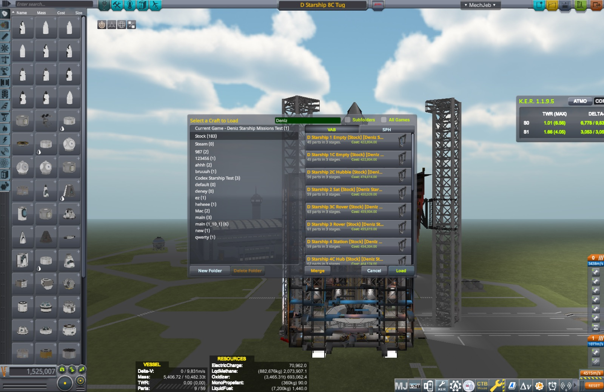
*In the VAB, click **Load** at the top right and type `Lusiados` in the search box. The craft appear with short names like "D Starship 2C Hubble".*

---

## 5. KSP crash course

Skip this section if you've already reached orbit in KSP.

### 5.1 The places in the game

| Place | What you do there |
|---|---|
| **Space Center (KSC)** | The main hub. Click buildings to go to them. |
| **VAB** (Vehicle Assembly Building) | Load and edit rockets. The **Launch** button (green flag, top right) puts the rocket on the pad. |
| **Flight** | You're flying. |
| **Map view** (press **M**) | Shows your orbit around the planet. Press M again to return. |
| **Tracking Station** | Lists all your vessels in flight. Switch to any of them from here. |

**Start a game:** choose **Start Game → New Game → Sandbox**. Sandbox means every part is unlocked and there's no money or science to worry about. Give it a name and click **Start!**. Or use the included *Lusiados Starship Missions Test* save.

### 5.2 The words you need

| Word | Meaning |
|---|---|
| **Apoapsis (Ap)** | The highest point of your orbit |
| **Periapsis (Pe)** | The lowest point of your orbit. If Pe is below 70 km on Kerbin, you'll fall back into the atmosphere. |
| **Orbit** | You're going sideways so fast that you keep falling *around* the planet instead of into it. On Kerbin that's about 2,200 m/s sideways at 80–150 km up. |
| **Prograde / Retrograde** | The direction you're moving / the exact opposite. Burning prograde raises your orbit, and burning retrograde lowers it. |
| **Delta-v (Δv)** | How much more you can change your speed with the fuel you have left, like a fuel gauge measured in m/s. |
| **TWR** (thrust-to-weight ratio) | Engine push divided by weight. **Above 1 you can go up. Below 1 you can't, even at full throttle.** For landing you want at least 1.2. |
| **SAS** | Holds your rocket's direction automatically. Turn it on with **T**. |
| **RCS** | Small side thrusters for turning and sliding sideways. Turn them on with **R**. |
| **Staging** | Pressing **Space** fires the next step of the rocket, like the launch release or booster separation. |
| **Action group** | A key that triggers a set of actions. D Starship uses the number keys 1–0 for this. |
| **Quicksave / Quickload** | **F5** saves and **hold F9** loads. Save before anything risky! On a Mac you may need **Fn+F5**. |

### 5.3 Reading the flight screen

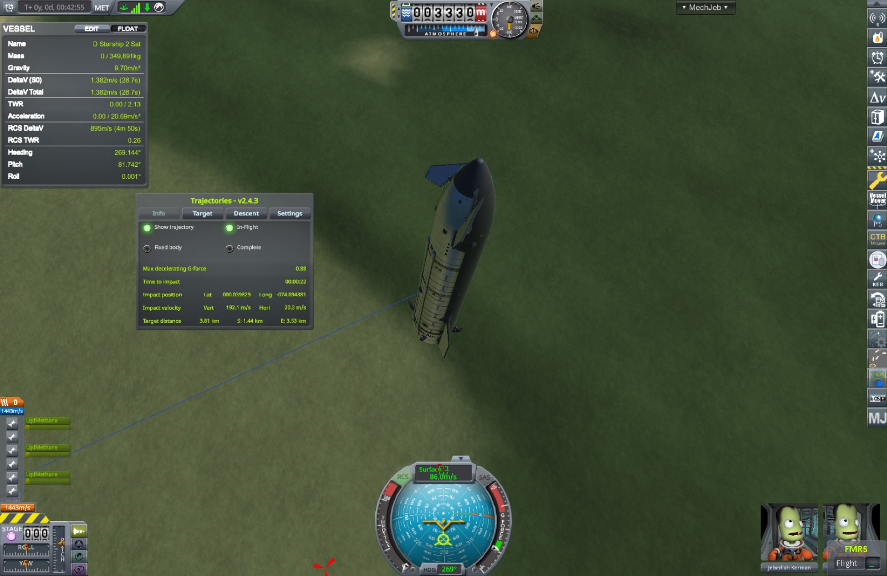
*A real flight screen during landing:*
- *Top left, the **KER** window: TWR (here 2.13 at full throttle), delta-v left, mass.*
- *Middle, the **Trajectories** window: predicted impact point, time to impact and distance to target.*
- *Bottom centre, the **navball**. It shows where you're pointing. Blue is sky and brown is ground. The yellow marker is your nose, and the green circle is the direction you're moving.*
- *Top, the **altimeter**.*
- *Bottom left, the **staging stack** and the throttle gauge.*

---

## 6. Your fleet

Every craft is a **Tower Launch** version: booster, ship and towers in one. In the VAB they show short names.

### Side-door family (compact cargo)

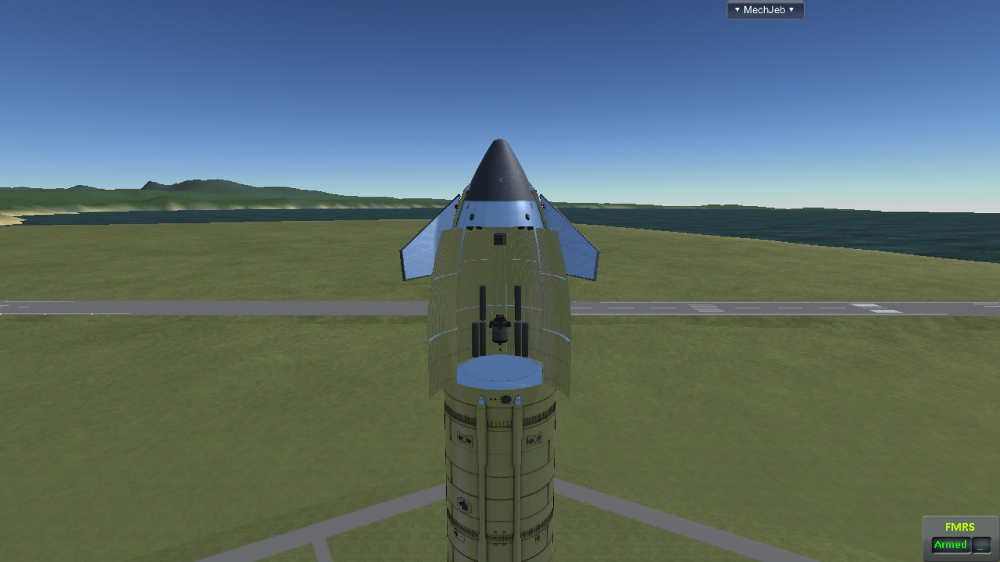

| VAB name | Payload | Use it for |
|---|---|---|
| **D Starship 1 Empty** | Empty bay with arm and release collar | **Your first flights.** Also for carrying your own creations. |
| **D Starship 2 Sat** | Satellite with engine, solar panels, antenna, RCS and docking port | Putting a satellite in orbit |
| **D Starship 3 Rover** | Small 4-wheel Mun rover with its own landing engine | Mun surface missions |
| **D Starship 4 Station** | 5-seat station habitat with docking ports | Building a space station |
| **D Starship 5 Refuel** | Methane/oxygen fuel pod with docking ports | Refuelling another Starship in orbit |
| **D Starship 6 Outpost** | 6-seat surface habitat with engine, legs and parachutes | Duna outpost |
| **D Starship 7 Rescue** | 1-seat rescue pod with engine | Rescuing stranded Kerbals |
| **D Starship 8 Tug** | Small asteroid tug with grabbing claw | Capturing small asteroids |

### Clamshell family (large cargo): the "C" craft

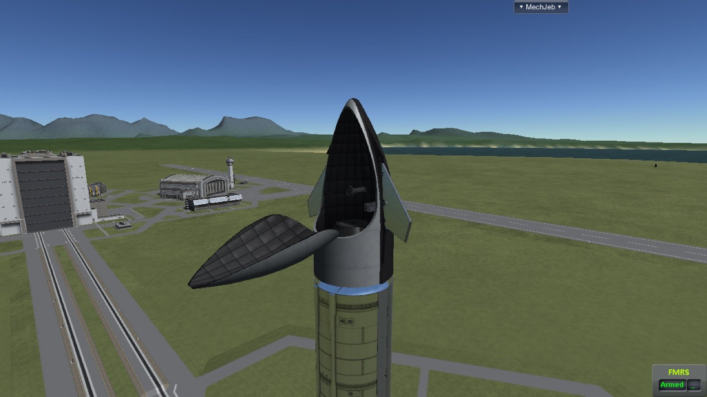

| VAB name | Payload | Use it for |
|---|---|---|
| **D Starship 1C Empty** | Big empty bay | Your own large payloads |
| **D Starship 2C Hubble** | ~4 m × 9 m space telescope with solar wings | Space telescope missions |
| **D Starship 3C Rover** | 6-wheel expedition rover, 2 seats | Bigger surface expeditions. It has no landing engine, so plan how it gets down. |
| **D Starship 4C Hub** | Large 3.75 m station hub, 6 docking ports | The centre of a big station |
| **D Starship 5C Depot** | Large orbital fuel depot | Fuel storage in orbit. Its ports are a bigger size than the hull port. |
| **D Starship 6C Base** | Large surface base with engine, legs and parachutes | Low-gravity surface bases |
| **D Starship 7C Crew** | 2-seat lander | Crew landings |
| **D Starship 8C Tug** | Heavy asteroid tug | Bigger asteroids |

### Practice craft

| VAB name | What it is |
|---|---|
| **D Booster Practice** | Super Heavy on its own, with no crew. Practise booster landings. |
| **Drone Ship - Landing Practice** | An ocean landing barge. Needs the Space X barge lander mod. |

**Every Starship has a permanent 2-seat cabin.** Before launch, in the VAB, click the **Crew** tab (top left) and make sure two Kerbals are in the cabin. Payload cabins (station, outpost, rescue and so on) have separate seats. Put people there only if that mission needs them.

---

## 7. The controls

### 7.1 D Starship keys: the number row, not the numpad

| Key | On Starship / the booster |
|---|---|
| **1** | Open / close cargo doors |
| **2** | Lock / unlock cargo doors |
| **3** (or **G**) | Extend / retract landing legs |
| **4** | Lock / unlock landing legs |
| **5** | Switch between **entry** and **landing** flap settings |
| **6** | **Landing engines.** Ship: the 3 sea-level engines. Booster: the centre cluster. |
| **7** | **All engines.** Ship: all 6. Booster: the full cluster. |
| **8** | Extend / retract the cargo arm |
| **9** | **Release the payload.** Works only when the doors are fully open, the arm is fully out, the engines are off and RCS is off. |
| **0** | Deploy the solar panels and antennas of *the vessel you're controlling* |

> **These are toggles.** Press once and **read the message on screen**. Don't mash them.
> **The starting state:** cargo is **locked**, and legs are **unlocked**.
> **Wait for things to stop moving before locking them.** A locked part ignores move commands. That's the most common "it doesn't work" cause.

**After a payload is released and you've switched to it:**

| Key | On the payload |
|---|---|
| **7** | Start its engine (if it has one) |
| **6** | Stop its engine |
| **5** | Deploy its parachutes (if it has them) |
| **0** | Unfold its solar panels and antenna |
| **G** | Its landing legs |
| **B** | Rover brakes |

### 7.2 Normal KSP flight keys (default bindings)

| Key | Does |
|---|---|
| **Space** | Next stage |
| **T** | SAS on/off |
| **R** | RCS on/off |
| **W / S** | Pitch (nose down / up) |
| **A / D** | Yaw (left / right) |
| **Q / E** | Roll |
| **Shift / Ctrl** | Throttle up / down |
| **Z** | Full throttle |
| **X** | **Cut throttle to zero** (learn this one!) |
| **Caps Lock** | Fine controls, for small, gentle inputs. *The original creator rebound this to Return on their Mac.* |
| **H / N** | RCS: move forward / back |
| **I / K** | RCS: move down / up |
| **J / L** | RCS: move left / right |
| **[ and ]** | Switch to nearby vessels |
| **M** | Map view |
| **F5 / hold F9** | Quicksave / quickload |
| **U** | Lights |

### 7.3 Right-click menus

Right-click a part in flight to open its menu. Useful ones:

- **The main tank (Starship core):** buttons for doors, lock, arm and payload, plus **RCS: high power** and **RCS: docking precision**.
- **The cargo bay:** doors, lock, arm, release, and **Prepare for return: stow and close**.
- **Super Heavy:** tower catch brackets (advanced, see section 17).

---

## 8. Before every flight

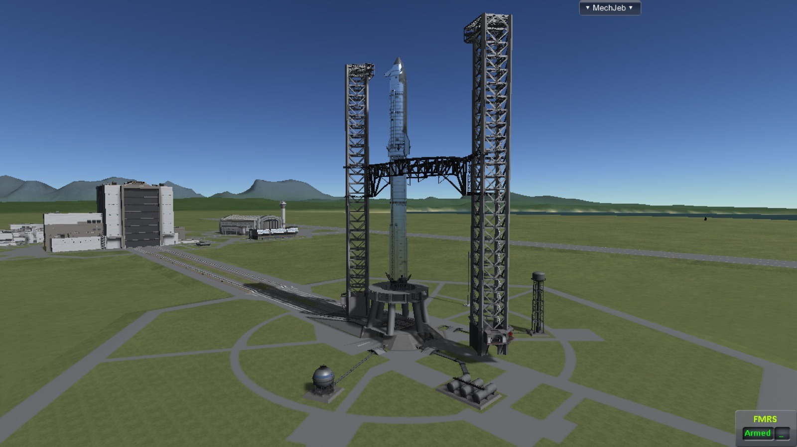

In the VAB:
1. Load the craft: **Load** (top right) → search `Lusiados` → pick one.
2. **Crew tab:** two Kerbals in the Starship cabin.
3. Click the green **Launch** flag.

On the pad, before pressing anything:

- [ ] Cargo **closed and locked**. That's how it starts, so don't touch 1 or 2.
- [ ] Arm **retracted**, legs **retracted**
- [ ] Throttle at **zero**. Press **X**.
- [ ] **SAS on.** Press **T**. The SAS light on the navball turns green.
- [ ] RCS off for now
- [ ] If you have FMRS: make sure its little window says **Armed**. It's visible in the first screenshot of this manual, bottom right.
- [ ] Turn off any autopilot you're not using, like MechJeb or Booster Guidance.
- [ ] **F5 quicksave.**

---

## 9. Mission 1: Launch to orbit

**Use D Starship 1 Empty.** Goal: a stable orbit around Kerbin at about 100–150 km.

### 9.1 Liftoff

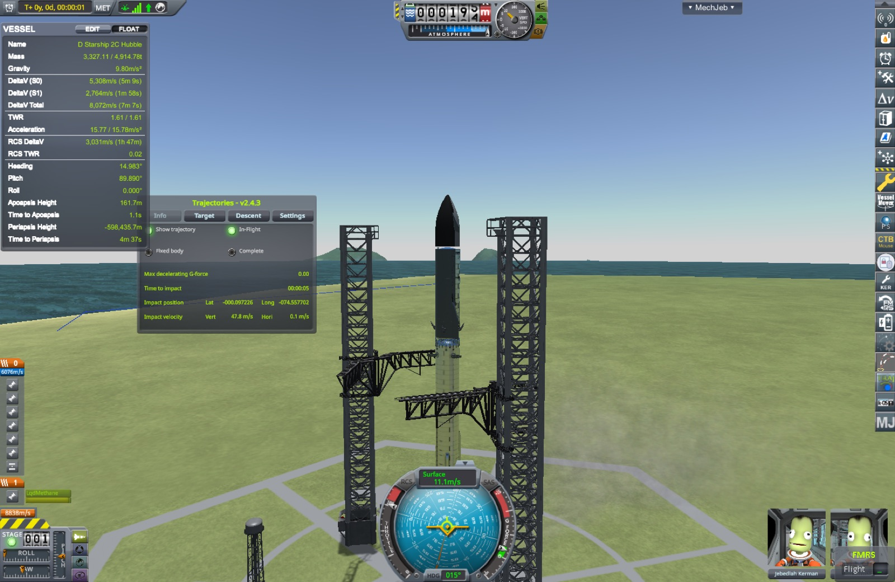

1. Raise the throttle with **Shift** to about **two thirds**. You want the rocket to rise gently. KER should show a TWR around **1.3–1.6**. The tested launches lifted off at TWR ≈ 1.6.
2. Press **Space ONCE.**
   - Super Heavy's engines start.
   - The tower arms swing away.
   - After the arms are clear, the mount lets go automatically. **This takes a few seconds. Do NOT press Space again.**
3. The rocket rises. The towers stay on the ground. That's correct.

### 9.2 The gravity turn: going sideways

The trick to orbit is to go **up first, then increasingly sideways (east)**.

1. Go straight up until about **1 km** altitude.
2. Gently tip the nose toward **east**: heading **90°** on the navball. Press **D** a little, or use **W/S** depending on your roll. Small inputs!
3. Keep the yellow nose marker **close to the green prograde marker** while the air is thick, below about 30 km. Big angles in thick air can flip the rocket.
4. As you climb, keep tipping further over. By about 35–45 km you should be pointing roughly 30–45° above the horizon.

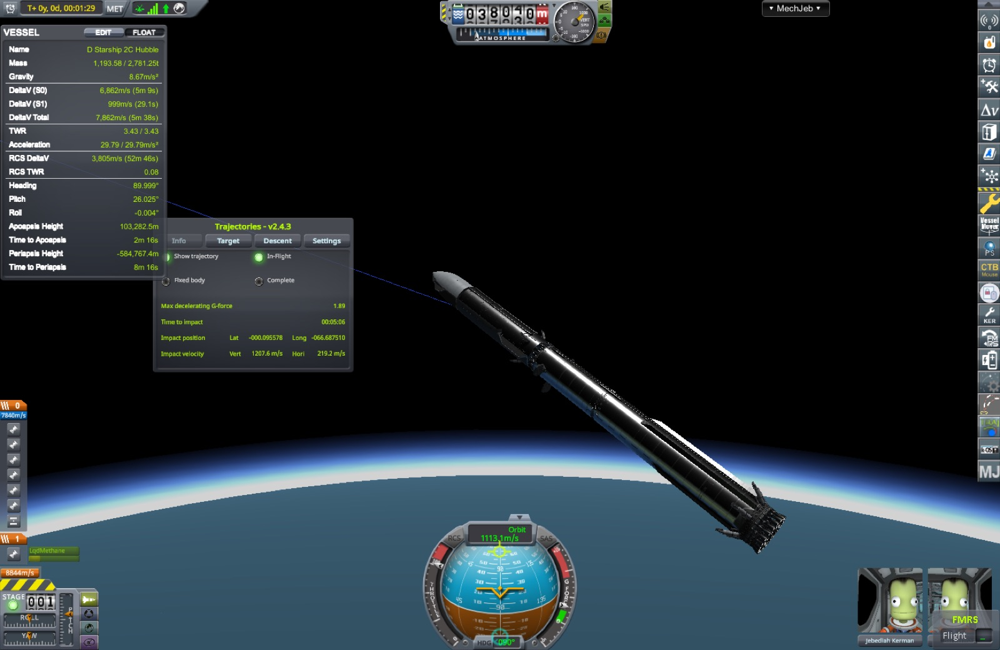

### 9.3 Separating the booster

The tested flights separated at about **45 km altitude, going about 1,000 m/s**.

1. Press **X** to cut the throttle.
2. Press **Space ONCE.** The booster separates, its engines shut off and **Starship's 6 engines become active**.
3. Wait a second for the two to drift apart, then raise the throttle again.

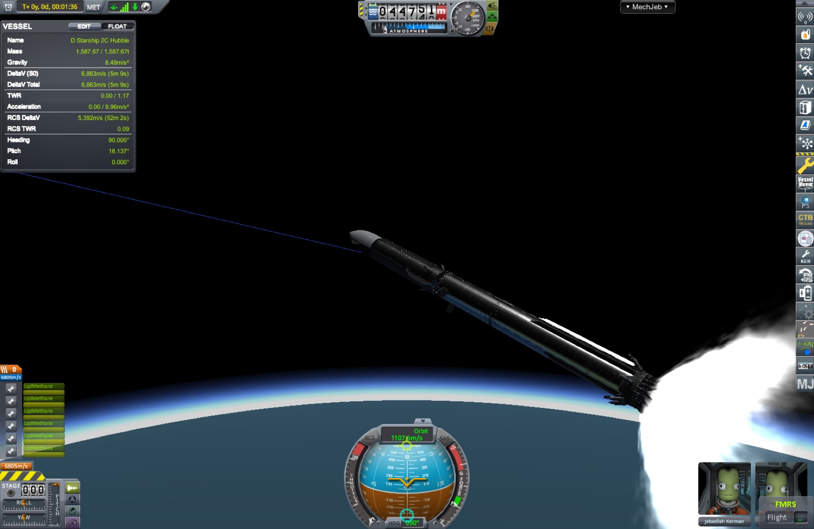

### 9.4 Finishing the orbit

1. Open map view with **M**. Watch the **Ap** marker (apoapsis).
2. Keep burning, mostly sideways (east, close to the horizon), until **Ap reaches about 120–150 km**. Then press **X**.
3. Coast. Time-warp with **.** (full stop) is fine while coasting outside the atmosphere. Stop warping **before** you reach Ap.
4. When you're about 20–30 seconds before Ap, point **prograde** (the green circle) and burn.
5. Watch **Pe** (periapsis) climb. When **Pe is above 80 km**, cut the throttle.

**You're in orbit!** F5 to save.

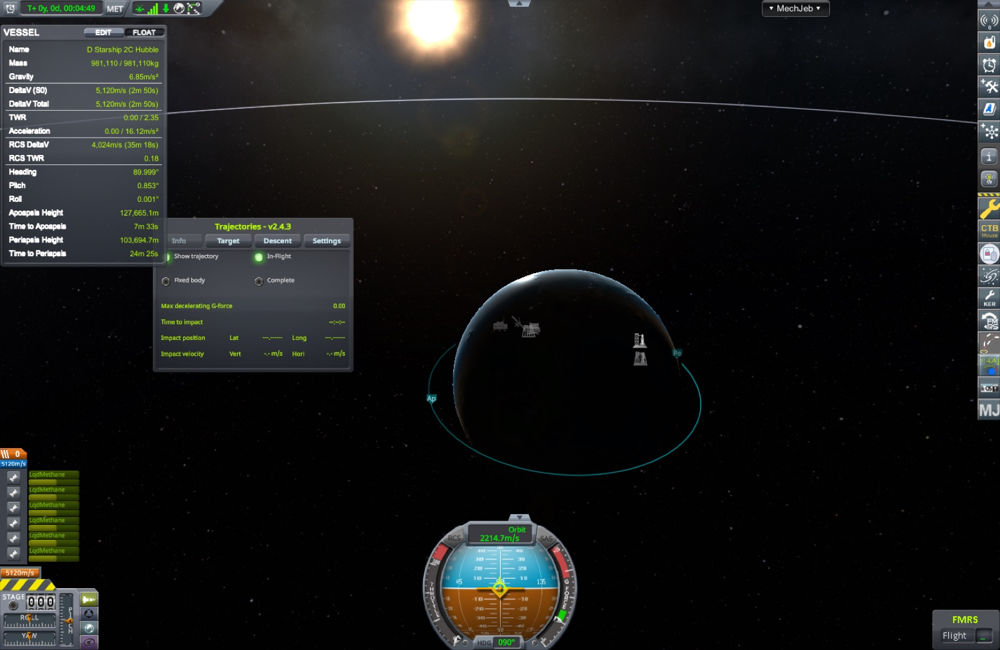

> **Using MechJeb instead:** open MechJeb → *Ascent Guidance*. Target orbit 150 km, inclination 0. Turn **Auto-stage OFF**, because you stage manually with this rocket. Lift off by hand first (step 9.1), then engage it. **It controls throttle AND steering.** Disengage it before pressing Space for separation, then re-engage. These are starting settings to try, not a tested preset.

---

## 10. Bringing the booster home

Flying the ship and the booster at the same time is too hard. **FMRS** solves this: you finish the ship's flight first, then FMRS takes you **back in time** to the moment of separation so you can fly the booster.

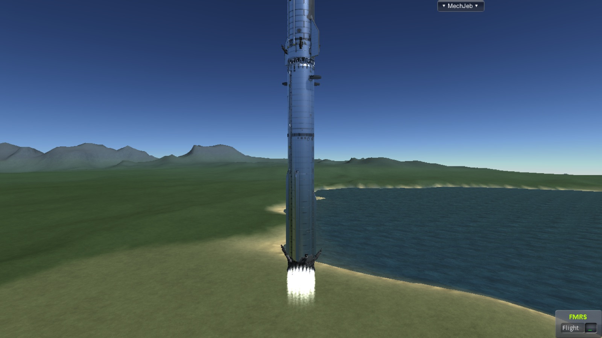

1. Arm FMRS on the pad (section 8).
2. After separation, finish getting Starship into orbit.
3. In the FMRS window, pick the **booster** and jump to it.
4. Fly it home (below), then use FMRS to go back to the main flight.

### Flying the booster back

1. Throttle **X**, turn on **SAS (T)** and **RCS (R)**. Press **7** for all engines.
2. In **Trajectories**, set a target on flat ground near KSC. *Not* on the launch mount.
3. **Boostback:** turn the booster to point **west**, back toward KSC, and burn. Watch the predicted impact point in map view move back toward KSC. Stop when it's on target.
4. Coast. As you fall into the atmosphere, point **opposite your direction of motion**: surface retrograde, the yellow circle with an X.
5. **Landing burn.** Check KER. If the TWR with **6** (centre engines) is above **1.2**, use 6. If not, stay on 7 (all engines). A heavy booster usually needs all the engines.
6. Press **3** for legs. Wait until they're fully out, then press **4** to lock them.
7. Brake early and land slowly. See section 12.4. The landing technique is the same.

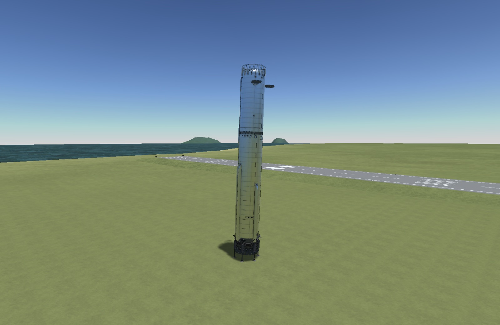
*A tested booster landing: upright, legs locked, 772 m from the pad.*

---

## 11. Delivering cargo in orbit

### 11.1 The safe release sequence (both families)

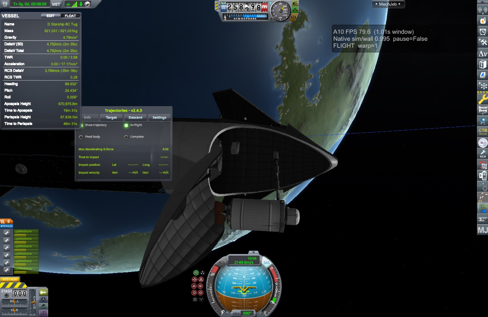

1. Be in a stable orbit with **Pe above 70 km**.
2. **Throttle to zero (X)**, and **RCS off (R)**. The release refuses to work while engines are pushing.
3. **SAS on**, set to plain **Stability Assist**, the first SAS button. *Don't* use prograde hold, because the ship slowly turns to follow it and the cargo can bump the hull. Wait until the ship stops rotating.
4. Make sure the bay faces empty space, with no other vessel nearby. **Don't time-warp** while things are moving.
5. **2** to unlock the doors. Read the message: *Unlocked*.
6. **1** to open the doors. **Wait until they're fully open.**
7. **8** to extend the arm. **Wait until it's fully extended**, about 9.6 m. It locks itself at the end.
8. **9** to release.

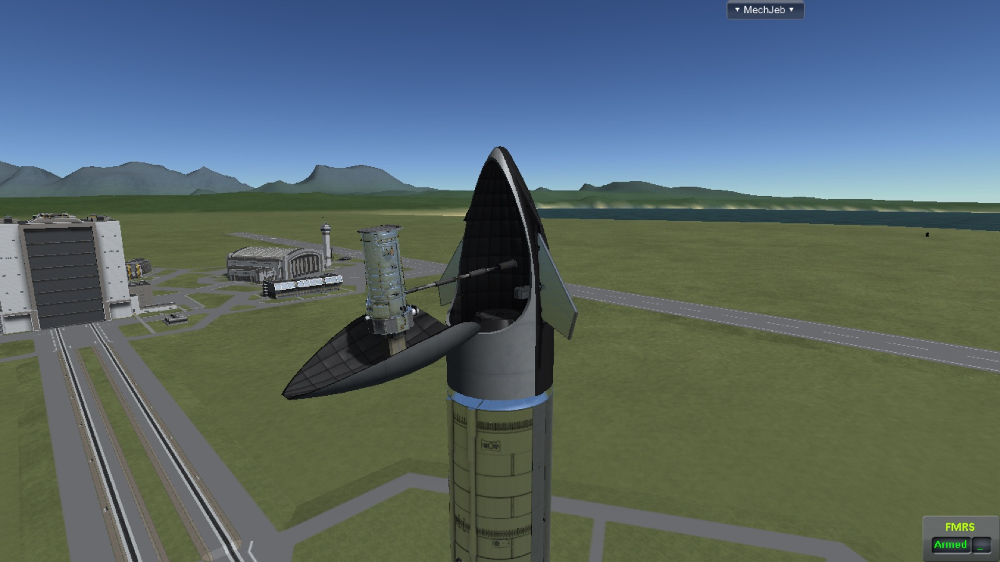

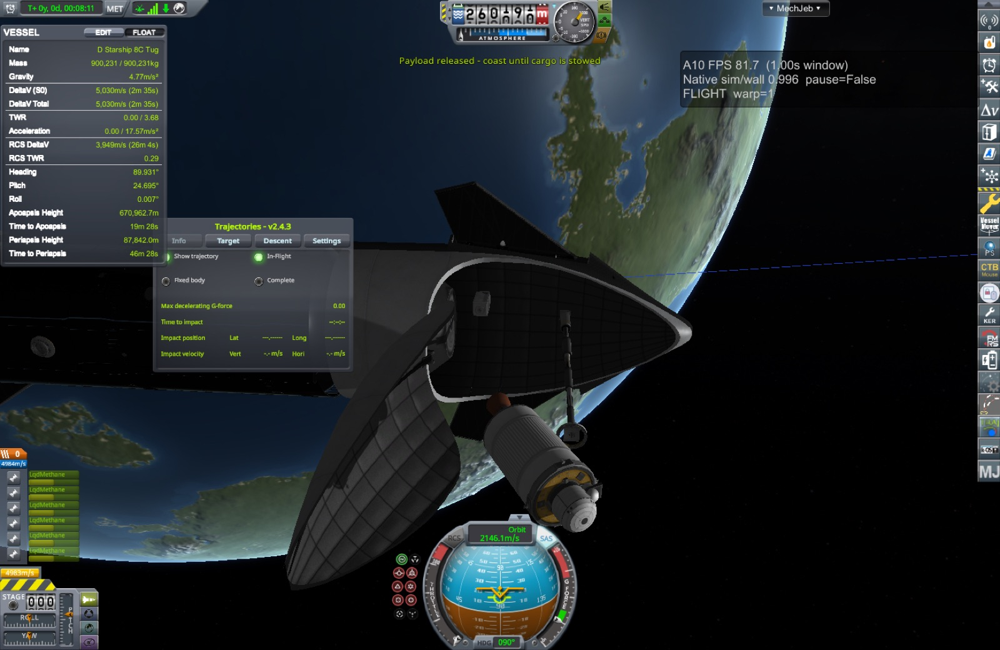

### 11.2 After release

- Switch to the payload with **[** or **]**.
- On the payload: **R** for RCS. Nudge it gently away with **H/N/I/J/K/L**.
- Once it's well clear, press **0** to unfold its panels and antenna. Start its engine with **7** only when it's clear of the ship.
- Check its own **Ap/Pe** in map view. Being released doesn't automatically mean it's in a good orbit.

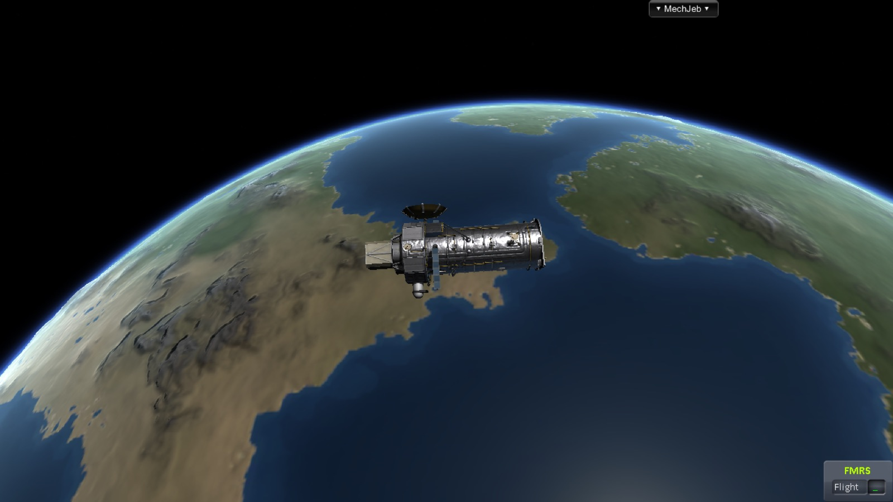
*The Hubble-style telescope after release, solar wings out. Use its right-click SpaceDust menu to run observations.*

### 11.3 Closing up

- **Clamshell (C) craft close themselves.** The arm retracts, and then, **once the payload has moved clear**, the nose closes and locks. Stay nearby until it finishes. If you saved and loaded in between, right-click the cargo → **Prepare for return: stow and close**.
- **Side-door craft:** switch back to Starship, then press **8** (retract the arm, and wait), **1** (close, and wait), **2** (lock). The doors can't close while the arm is out.

---

## 12. Coming home

### 12.1 Get ready

- Arm retracted, doors **closed and locked**, panels folded
- Check KER: is the landing TWR with **6** above **1.2**? If not, you have too much fuel or cargo, or you need **7**.
- In **Trajectories**, set your landing target, for example near KSC.
- **F5.**

### 12.2 Deorbit

1. Point **retrograde**, the opposite of the green prograde marker.
2. Burn a little, until your **Pe is around 30–40 km**. Watch the Trajectories prediction in map view and adjust so it lands near your target. It's easier to start too long and shorten with small burns.
3. Burn on the **opposite side of Kerbin** from KSC so the descent ends near it. This takes practice. Quickload and retry.

### 12.3 Entry

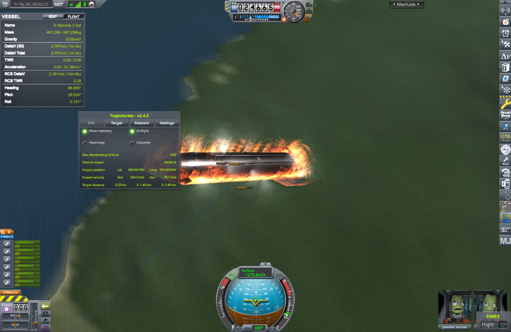

- Press **5** for the **entry flap** setting.
- Keep heating under control. Avoid very steep or very shallow paths.
- Belly-first entry is like the real Starship. Present the shielded side to the airflow. The flaps help, but **pressing 5 does not fly the belly-flop for you.**
- Simpler option for beginners: enter **nose-first, pointed surface retrograde**. MechJeb's *Smart A.S.S. → SURF → SVEL−* holds this for you.

### 12.4 Landing burn: the part that takes practice

1. Several kilometres up: press **5** again (landing flaps), **X**, then **6** (landing engines). **Always press X before 6 or 7**, otherwise the rocket jumps.
2. **3** for legs, wait until they're out, then **4** to lock.
3. **Start braking early.** Watch **altitude above terrain** in KER, not sea-level altitude.

   Rule of thumb: stopping distance ≈ speed² ÷ (2 × 9.81 × (TWR − 1)).
   - At **150 m/s** with **TWR 2**, you need about **1.15 km** to stop.
   - With **TWR 1.5**, you need about **2.3 km**.
   - Start well above that.
4. Burn hard to slow down, then ease off. Hovering needs about **1/TWR** throttle. At TWR 2 that's about 50%.
5. Aim for:
   - **5–10 m/s** down while still high
   - **1–3 m/s** in the last tens of metres
   - **under 1 m/s** at touchdown
   - **almost zero sideways speed**
6. Once the legs touch and the rocket settles, press **X**.

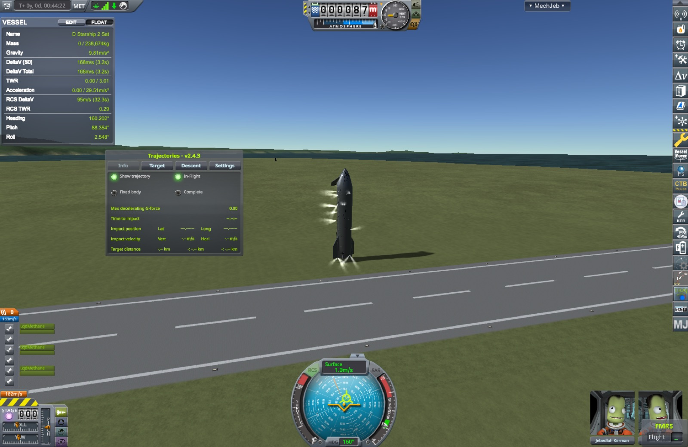
*A tested orbital return and landing: intact, 630 m from the pad.*

---

## 13. Docking and refuelling

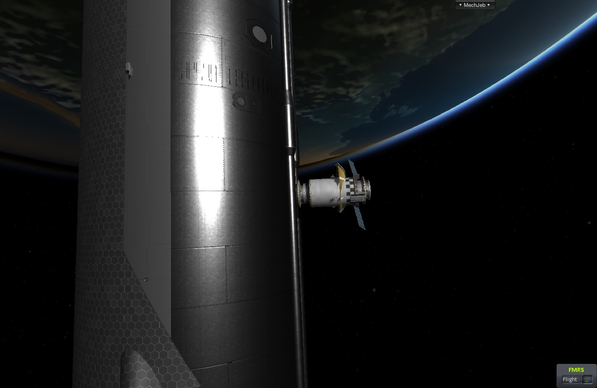

Use **D Starship 5 Refuel** to bring fuel to another Starship (for example a *1 Empty*) in orbit.

1. **Rendezvous.** Select the other ship as your target: right-click it in map view → **Set as Target**. MechJeb's *Maneuver Planner* has a simple sequence:
   1. Match planes
   2. Hohmann transfer to the target
   3. Fine-tune the closest approach
   4. Match velocities at closest approach
2. Get within about 200 m, with almost zero speed relative to the target.
3. **Release the fuel pod** (section 11) near the receiving ship. Docking the small pod is easier than docking a whole Starship.
4. Right-click the main tank → **RCS: docking precision**, then press **R** and **Caps Lock** (fine controls).
5. Right-click your docking port → **Control from here**. Right-click the target's port → **Set as Target**.
6. Approach with short RCS taps. **Under 0.2 m/s near contact.** MechJeb's *Docking Autopilot* at 0.25 m/s worked in testing.
7. When docked, open the resource transfer: right-click a tank and use the resource panel. Move **LqdMethane** and **Oxidizer** into the Starship core.
   - The compact pod holds **2400 methane + 800 oxidizer**. That's a top-up, not a full tank.
   - Normal **LiquidFuel does not work** in Starship engines. You need methane.
8. Right-click the port → **Undock**.

> The hull docking port and the compact pods use the standard **Clamp-O-Tron** size. The big **5C Depot** has larger ports that **don't** fit the hull port.

---

## 14. Going to the Mun

Use **D Starship 3 Rover**. Land Starship first, then lower the rover.

1. **Orbit Kerbin** (section 9).
2. **Transfer:** target the Mun, then MechJeb *Maneuver Planner* → **Hohmann transfer**. Check map view: it must show a Mun encounter. Execute the node.
3. **Capture:** at the Mun's periapsis, burn retrograde until you're in a circular orbit around the Mun.
4. **Land:**
   - The Mun has **no air, so no parachutes or flaps help.**
   - Use engines **6** and the landing technique from section 12.4.
   - Pick **flat ground**. MechJeb's *Landing Guidance → Land somewhere* can do this.

   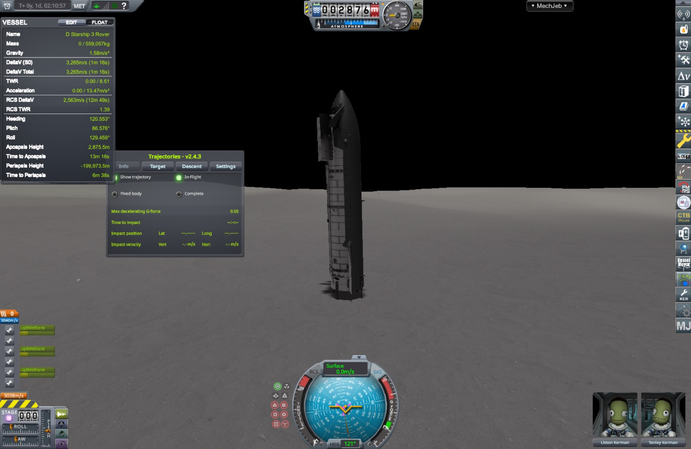

5. **Deliver the rover:**
   1. Starship must be **upright and settled**, with the bay facing open ground.
   2. Press **2**, **1**, **8** (wait for each), then **9**.
   3. **Immediately** switch to the rover with **]**.
   4. Press **7** to start its little engine and land it gently. MechJeb *Land somewhere* works.
   5. Once it's down, **B** brakes.
   6. Drive with **W/A/S/D** while controlling the rover. Go gently.

   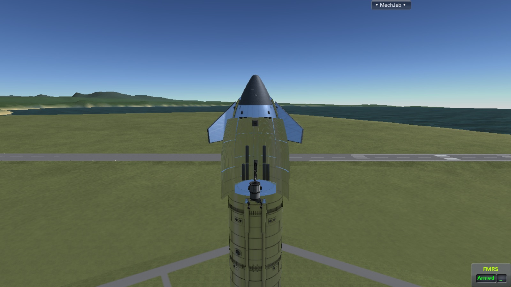
   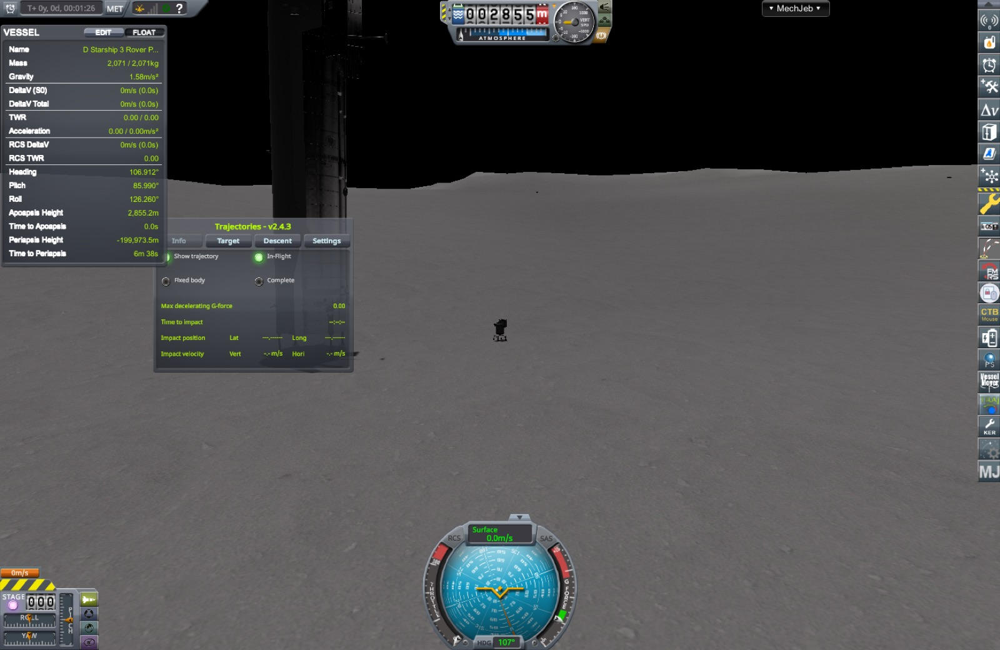

6. **Close up:** switch back to Starship and press **8**, **1**, **2**.
7. **Go home:** launch from the Mun, then use MechJeb's *Return from a moon*. **Check that the predicted Kerbin Pe is around 30–60 km** before burning. Then follow section 12.

> **Honest note:** the Mun landing, rover delivery, rover drive and return burn were all tested. Standing upright on Kerbin after a Mun return wasn't fully achieved, because fuel was very low. Bring fuel and practise.

---

## 15. Going to Duna

Use **D Starship 6 Outpost** for the small habitat, or **6C Base** for the big one. You'll need **refuelling in orbit** first (section 13). The tested mission refuelled with a tanker before leaving.

1. Launch to Kerbin orbit. Launch a *5 Refuel* and top up (section 13).
2. **Transfer window:** MechJeb *Maneuver Planner* → **Advanced transfer to another planet** → Duna. It finds the right time. Warp to it, execute, then do a small correction burn halfway.
3. **Capture** into a safe orbit around Duna. The tested mission used about 660 m/s.
4. **Land:** Duna's air is thin. Flaps and parachutes help a bit, but you still need engines. Pick flat ground. Same landing technique as before.

   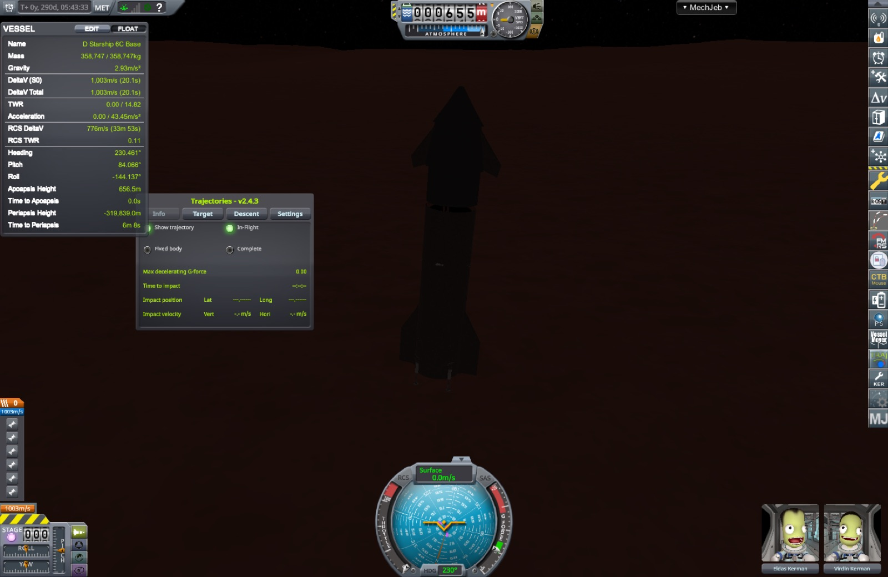

5. **Release the base or outpost:**
   1. Unlock, open, extend the arm, release.
   2. Switch to the payload.
   3. Press **7** for its engine and fly it down gently. Use **G** for its legs.
   4. Press **0** to deploy its solar panels.

   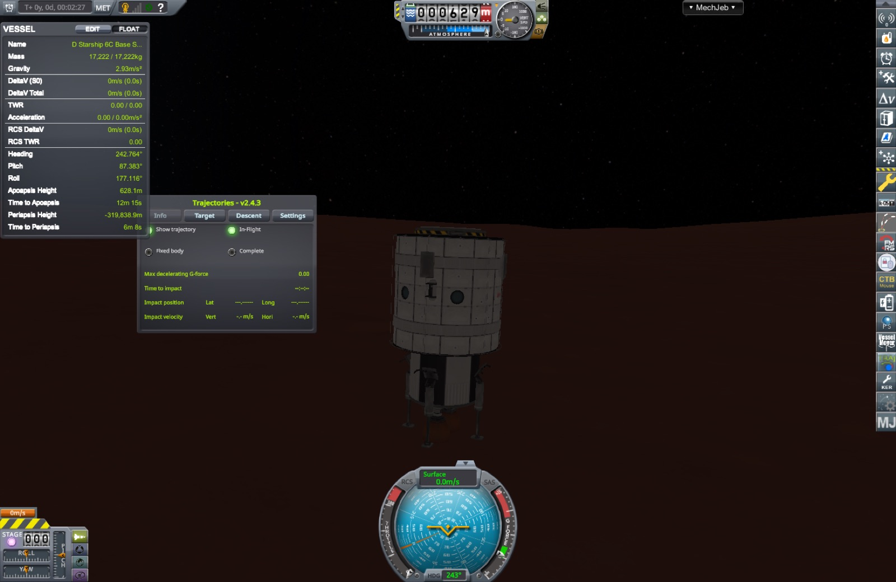

6. **Coming back from Duna needs a lot of fuel**, roughly 4,000 m/s of delta-v. Without refuelling on Duna's surface or in orbit, Starship **can't** return. Plan it as a one-way trip or a refuelling campaign.

---

## 16. Booster landing on the drone ship

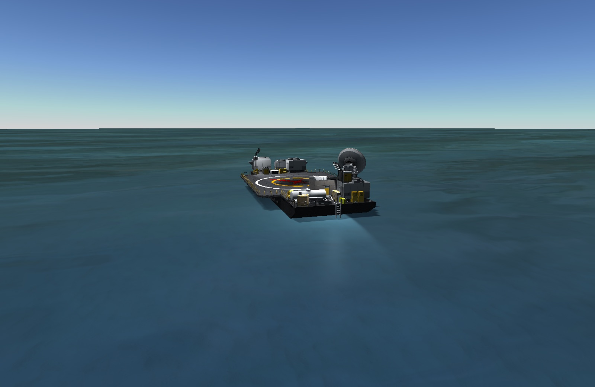

1. Load **Drone Ship - Landing Practice** and launch it. It spawns at sea. Or move it with VesselMover.
2. For an easy start, launch **D Booster Practice**.
   - In the VAB, right-click its tanks and lower **both** LqdMethane and Oxidizer to about **5%**. A full booster is far too heavy to land.
   - With infinite fuel turned on in the cheat menu (**Alt+F12**, or on a Mac **Option+Fn+F12**), it can't run out, but fuel *weight* still counts.
3. Fly to the barge and land with the section 12.4 technique. The tested landing used **all engines (7)**, legs **3** then **4**, and touched down about 4 m from the deck centre.

---

## 17. Advanced: catching the booster with the tower

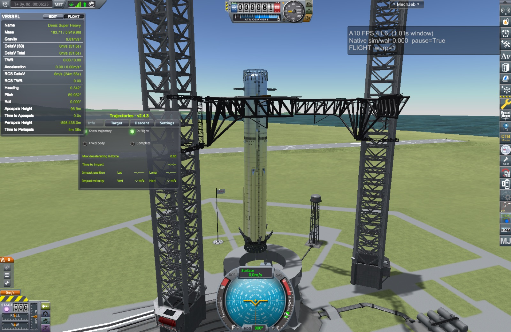

This is for experienced pilots. The tower closes and holds, but **you still fly the booster in to a near-perfect hover.**

**Before launch:**
1. Right-click **Super Heavy** → set **Bracket angle 75°** → **Enable catch brackets**. Set the angle **first**.
2. Leave the tower arms in their closed launch position and let them settle. Then right-click the nearby tower → **Calibrate catch on pad**. It must say the target was measured from both rails.
3. Launch normally. Keep the other tower disarmed.

**The catch:**
1. Fly the booster back and hover at the tower's arms.
2. Right-click the calibrated tower → **Arm / abort tower catch**.
3. The arms close only when **all** of these hold for one second:
   - error ≤ **0.5 m**
   - speed ≤ **0.2 m/s**
   - spin ≤ **0.01 rad/s**
   - tilt ≤ **3°**
4. When caught: throttle to zero, and turn off RCS and SAS. Let it settle.

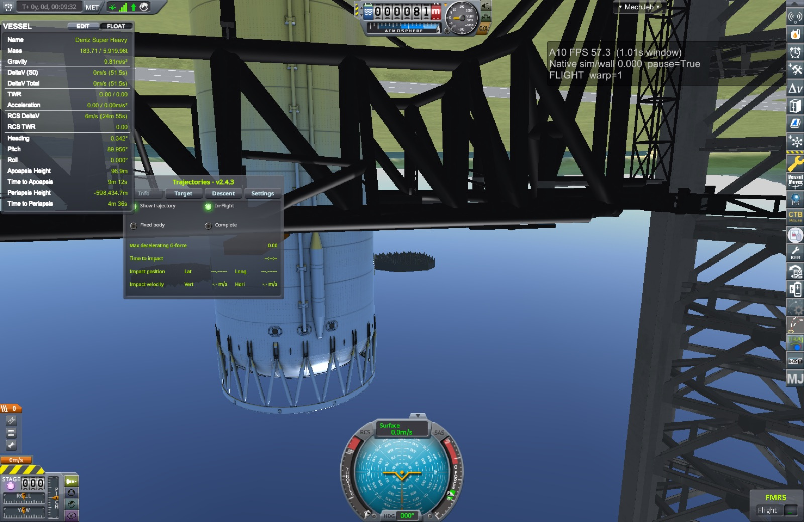

**Releasing a caught booster:**
1. Throttle up first. It needs at least 1.05× the booster's weight.
2. Right-click → **Safe release caught booster**.
3. Fly up and clear of the arms.

Never use normal staging to release a catch.

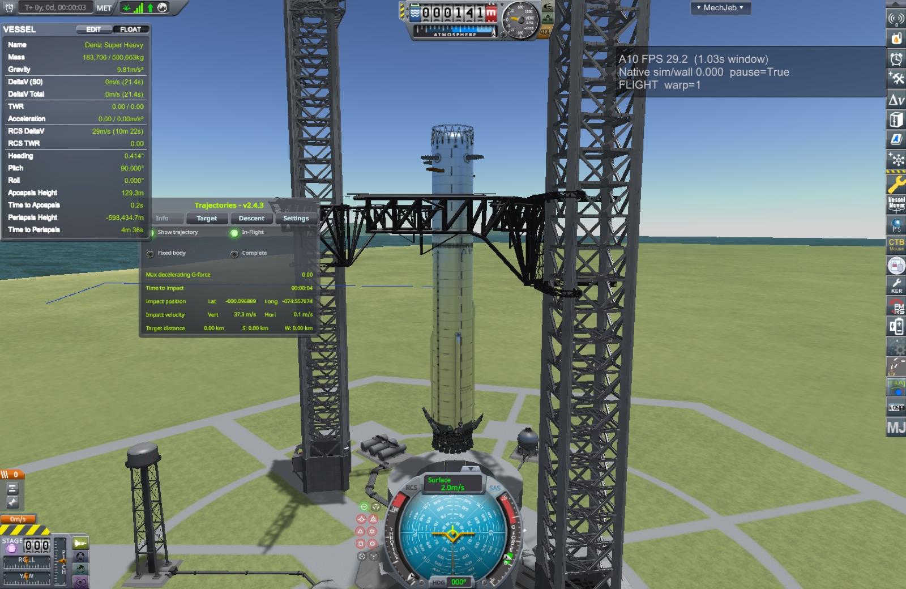

---

## 18. Crew, EVA and the cabin

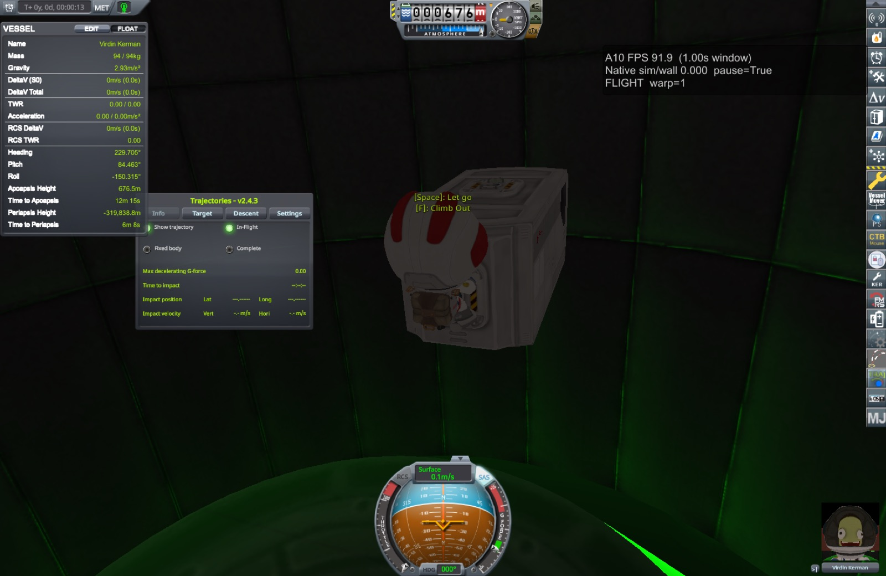

- The 2-seat cabin is **inside the cargo bay**. Unlock (**2**) and open (**1**) the doors before going on EVA. The hatch faces the cargo opening.
- To EVA: click a crew portrait (bottom right) → **EVA**.
- Climbing a landed Starship is a long way up. Be careful, because Kerbals can fall.
- To move crew between docked ships: right-click a crew part → **Transfer Crew**.

---

## 19. When something goes wrong

| Problem | Fix |
|---|---|
| Doors won't open | They're locked. Press **2** once, check the message says *Unlocked*, then **1**. |
| Doors won't close | The arm is still out. Press **8**, wait, then **1**. Never force it. |
| **9** does nothing | Doors not fully open, arm not fully out, engines still pushing, or RCS on. Read the message. |
| Legs don't move | They're locked. Press **4**, then **3**. Lock again only once they've stopped. |
| The rocket jumps when I press 6 or 7 | The throttle was up. Always press **X** before switching engine modes. |
| Full throttle can't stop the fall | TWR below 1. Wrong engines? Use **7**. Too heavy? Use less fuel. Tilted? Straighten up. |
| Throttle moves on its own | An autopilot is on: MechJeb, Booster Guidance and so on. Turn it off. |
| The payload engine won't start | Still attached, wrong vessel selected, or that payload has no engine. |
| The landing misses the target | Holding direction isn't steering. Watch the Trajectories impact point and correct early. |
| The rocket wobbles a lot | Check that **Kerbal Joint Reinforcement Next** is installed. |
| The craft won't load ("missing parts") | A required mod is missing or the wrong version. Re-check section 3. SEP must be **3.1.0**, and the Tundra files are needed for the C craft. |
| The ship bounces on landing | You were still braking too hard at touchdown. Ease the throttle before contact. |
| Fine controls don't work | Default key is **Caps Lock**. Check *Settings → Input*. |
| Weird error in map view right after a launch | Close map view before launching another craft. SpaceDust can complain otherwise. |

---

## 20. One-page cheat sheet

```
PAD:      X (throttle 0) · T (SAS on) · F5 · throttle ~2/3 · SPACE once · wait
CLIMB:    straight up to 1 km → tip east (heading 90) → follow prograde
STAGE:    ~45 km / ~1000 m/s → X → SPACE once → throttle up
ORBIT:    burn until Ap 120-150 km → X → coast → prograde burn at Ap until Pe > 80 km

CARGO:    X · RCS off · SAS stability · 2 unlock · 1 open · 8 arm · 9 release
          C-craft close themselves · side doors: 8 → 1 → 2
PAYLOAD:  ] switch · R · nudge away · 0 panels · 7 engine on · 6 off

LANDING:  bay closed+locked · Trajectories target · retrograde burn to Pe 30-40 km
          5 entry flaps · ... · 5 landing flaps · X · 6 engines · 3 legs · 4 lock
          brake EARLY · 5-10 m/s high · 1-3 m/s low · <1 m/s touch · X

KEYS:     1 doors · 2 lock · 3/G legs · 4 leg lock · 5 flaps · 6 landing eng
          7 all eng · 8 arm · 9 release · 0 panels · R RCS · T SAS · X cut
```

---

## 21. What has been tested, honestly

All of this was tested by actually flying it in KSP 1.12.5, October 2026. Some tests used autopilot scripts for steering and throttle, so the human timings in this manual are good starting points rather than proven recipes.

| Tested and passed | |
|---|---|
| All 16 craft load, stage and open/close their cargo on the pad | ✅ |
| All 16 lift off, release from the tower and separate the booster | ✅ |
| Reaching orbit (Empty and Hubble) | ✅ |
| Releasing the telescope and satellite in orbit | ✅ |
| Starship returning from orbit and landing near KSC | ✅ |
| Super Heavy flying back and landing on land | ✅ |
| Super Heavy landing on the ocean barge | ✅ |
| Docking, transferring fuel and undocking in orbit | ✅ |
| Mun landing, rover delivery and drive, Mun takeoff, return burn | ✅ |
| Duna mission with orbital refuelling, landing, base delivery | ✅ |
| EVA and ladder | ✅ |
| Tower catch, hold and powered release | ✅ (within its tested limits) |

| Not proven yet | |
|---|---|
| Starship landing on the ocean barge | ❌ ran out of fuel margin |
| Standing safely on Kerbin after a Mun return | ⚠️ partial: fuel too low |
| Return from Duna | ⚠️ not attempted: needs far more fuel |
| Booster Guidance autopilot on this booster | ⚠️ not validated |
| Precise telescope pointing | ⚠️ partial |
| Booster separation without any contact | ⚠️ partial |

The full engineering history is in [`docs/dev/`](dev/).

---

*D Starship by Lusiados. Starship and Super Heavy models from Starship Expansion Project, towers from Starship Launch Expansion, clamshell nose model from Tundra Exploration. None of their assets are redistributed here; install them from their authors.*
